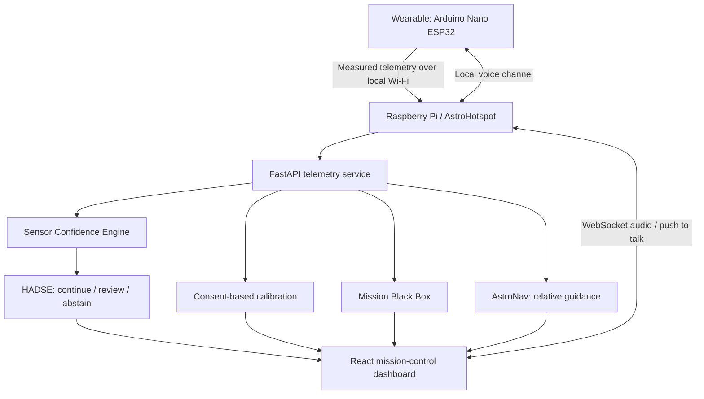

# AstroVital X

### Astronaut health monitoring that stays useful when Earth cannot answer immediately.

**Team MarsUp** · **NASA Space Apps Challenge 2026** · **Sivas Local Event: 4th Place** · **Global Nominee**

**Challenge:** [Create Health Monitoring Software for Astronauts on Space Missions](https://www.spaceappschallenge.org/2026/challenges/health-monitoring-software/)

> **In one sentence:** AstroVital X connects a wearable sensor unit to a Raspberry Pi mission station so a crew can monitor health-related measurements, see when those measurements are unreliable, communicate locally, and receive experimental navigation assistance without requiring an internet connection.

## The problem

On long-duration missions, crews cannot rely on immediate responses from Earth. Astronauts also work in demanding environments where motion, sensor contact, and communications interruptions can make raw health readings difficult to interpret.

A number on a screen is not enough. A useful health-monitoring system should answer three questions:

1. **What is being measured right now?**
2. **Can we trust this measurement enough to interpret it?**
3. **Can the astronaut and a nearby operator respond locally?**

NASA's challenge calls for software that gathers health indicators and helps astronauts evaluate and act on their health status. We designed AstroVital X around that requirement: **measure → assess data quality → explain → communicate**.

## Our solution

AstroVital X is a **working terrestrial research prototype** composed of a wearable device, a local processing/communications station, and a mission-control interface.

| Component | What it contributes |
| --- | --- |
| **Wearable sensor unit** | Acquires heart rate, estimated SpO₂, movement, orientation, and environmental measurements; displays local guidance on an OLED screen. |
| **Sensor Confidence Engine** | Checks whether incoming measurements are usable, considering freshness, signal quality, excessive motion, and missing values. |
| **HADSE** | Converts usable telemetry into *explainable, rule-based* mission-support states: `continue`, `review`, or `abstain`. |
| **Personal calibration** | With consent, creates an individual reference from suitable readings and flags repeated deviations as candidates for human review. |
| **AstroHotspot + two-way radio** | Keeps telemetry and live voice communication operating over a Raspberry Pi-hosted local Wi-Fi network, without internet access. |
| **AstroNav** | Adds relative heading, schematic route alternatives, and return-to-base guidance to the local mission-support environment. |
| **Mission Black Box** | Records mission events and telemetry assessments for subsequent review. |

**The key design decision:** When telemetry is missing, stale, or unreliable, the system explains the problem rather than inventing a health conclusion. AstroVital X is **not** a medical diagnostic device and does not make autonomous clinical decisions.

## How it works



**Telemetry path:** The ESP32 reads connected sensors and sends packets to the Pi. FastAPI receives them, the Sensor Confidence Engine checks data quality, HADSE generates a transparent result where appropriate, and the dashboard displays the current situation and its data source.

**Communication path:** The Pi creates **AstroHotspot**, a local Wi-Fi access point. Within tested coverage, the wearable and dashboard can exchange data and two-way voice without relying on internet service. The voice bridge uses WebSocket and 8 kHz, 8-bit unsigned mono PCM audio. This is a **local radio-style intercom prototype**, not a satellite link.

**Navigation path:** The current AstroNav prototype uses calibrated magnetic heading and estimated steps to track *relative* movement. Its selectable A/B/C paths are geometric demonstrations, not surveyed terrain routes.

## What makes AstroVital X different?

Rather than treating health monitoring as an isolated chart, the prototype combines **four connected capabilities**:

- **Uncertainty is visible.** The system distinguishes `measured` from `simulated` data and refuses to issue recommendations when quality checks fail.
- **Interpretation is explainable.** HADSE returns an explicit reason and requires human oversight, rather than making opaque medical claims.
- **The response can stay local.** Live telemetry and an operational two-way voice channel share the same independent Raspberry Pi network.
- **The astronaut has a useful interface.** The wearable OLED and dashboard expose directional information, with AstroNav serving as an experimental support tool beyond the core health challenge.

This integration is our **design contribution**. We do not claim to have invented pulse sensing, Wi-Fi networking, or navigational algorithms.

## Prototype features and evidence

| Feature | Current evidence / status | Important boundary |
| --- | --- | --- |
| Sensor telemetry and dashboard | Real ESP32-to-Pi telemetry was observed; API and dashboard were tested. | Optical health readings are estimates, not medical-grade measurements. |
| Sensor quality assessment | Backend and frontend test scenarios cover low signal, motion, missing readings, stale timestamps, and link loss. | Thresholds are demonstrative, not clinical standards. |
| HADSE | Rule-based states and reasons implemented; automated tests are included in the repository. | No trained AI health model; no diagnosis. |
| Personal baseline | Consent-gated recording and per-channel baseline comparison implemented. | Deviation flags are **unverified candidates**, not confirmed health anomalies. |
| Local communication | AstroHotspot is operational in the prototype; the team demonstrated two-way voice communication. | No space-environment testing or quantified Mars-range claims. |
| AstroNav | Relative-heading/step-based logic, A/B/C schematic paths, and return-to-base workflow implemented and software-tested. | No reliable absolute positioning, obstacle avoidance, or real Mars terrain integration. |
| Mission Black Box | Local event and assessment logging implemented. | Private records are not published in this repository. |

A separate [verification record](docs/VERIFICATION.md) documents the **November 14 baseline tests** and their precise scope. Later navigation and audio changes are described in the accompanying source and documentation. We intentionally do not present software tests as proof of flight-ready hardware.

### The 10-meter demonstration is not a project limitation

Our live AstroNav demonstration creates a goal **10 meters** ahead of the starting direction because it is practical to show in a room or test area. It is a **controlled demo configuration**. The long-term concept is terrain-aware navigation using genuine Martian mapping and elevation resources; **that integration has not yet been implemented or validated**.

## Hardware / Bill of Materials

The following are the main parts used in or planned around the prototype's assembled configuration. Exact component variants and the audio/power circuit should be checked against the physical build before replication.

| Component | Qty. | Function |
| --- | ---: | --- |
| **Arduino Nano ESP32** | 1 | Wearable controller, sensor acquisition, local Wi-Fi link |
| **Raspberry Pi** | 1 | Wi-Fi access point, local FastAPI backend, audio relay, and dashboard host |
| **MAX30102 optical pulse sensor** | 1 | Heart rate and estimated SpO₂ acquisition |
| **MPU6050 IMU** | 1 | Acceleration and movement measurements |
| **HMC5883L/QMC5883-compatible magnetometer** | 1 | Magnetic heading measurements |
| **BMP180** | 1 | Barometric pressure and temperature |
| **0.96-inch SSD1306 OLED display** | 1 | Wearable readings and direction prompts |
| **Analog microphone / audio input** | 1 | Wearable-side voice input |
| **Speaker + suitable output circuit** | 1 set | Wearable-side voice playback |
| **Button or touch input** | As fitted | On-device interaction |
| **Wearable enclosure and strap** | 1 set | Physical mounting and wearing |
| **Power, USB cables, wiring and connectors** | As needed | Power and prototyping |
| **Laptop or other client device** | 1 | Operator dashboard and microphone interface |

**Note:** nRF24 modules were explored during development, but the demonstrated **AstroHotspot** telemetry/voice network is Wi-Fi-based and does not require nRF24 hardware. Parts combined into a multi-sensor module should not be counted as separate physical boards when reproducing the build.

## 3D enclosure and printable parts

The project includes [parametric OpenSCAD sources, 3D-printable STL files, mechanical previews, and assembly notes](hardware/3d/README.md) for V3.3/V3.2 housing iterations and a legacy V3.1 revision. These are **unverified physical prototypes**, not flight-qualified designs.

## Software stack

- **Wearable:** Arduino C/C++ on Arduino Nano ESP32
- **Backend:** Python, FastAPI, Pydantic, asynchronous WebSocket audio bridge
- **Dashboard:** React, TypeScript, Vite
- **Storage:** SQLite for mission events; optional local CSV for consent-based calibration
- **Deployment:** Raspberry Pi OS/Linux, local access point, systemd services
- **Development:** Visual Studio Code, GitHub, Figma; AI-assisted coding, debugging, editing, and documentation tools

### Repository map

```text
backend/                 FastAPI, telemetry, HADSE, calibration, AstroNav, audio bridge, tests
frontend/                Mission-control UI, maps, status displays, radio controls, tests
deploy/raspberry-pi/      Service units and startup scripts
docs/                    Deployment, validation, radio and calibration notes
tools/                   Local development and operator utilities
```

The live ESP32 firmware, complete wiring diagram, and enclosure design may be stored outside this repository. Please do not assume they are published here unless corresponding files are available.

## Reproduce the software

You can run the backend and dashboard on a development computer **without physical sensors**, using the included simulation/test paths. Measured and simulated packets remain explicitly distinguished.

**Requirements:** Python 3.11+ and Node.js 22+.

```bash
# Terminal 1: backend
cd backend
python -m venv .venv
# Activate .venv (Windows or Linux/macOS)
python -m pip install -e ".[dev]"
python -m uvicorn app.main:app --host 127.0.0.1 --port 8000
```

```bash
# Terminal 2: dashboard
cd frontend
npm install
npm run dev
```

Open **http://127.0.0.1:5173**. The API runs on port **8000**. The Raspberry Pi deployment uses the same services over its configured local network; see [`docs/DEPLOYMENT.md`](docs/DEPLOYMENT.md).

**Run tests:**

```bash
cd backend && python -m pytest -q
cd ../frontend && npm test && npm run build
```

For radio configuration and browser microphone permissions, see [`docs/LIVE_AUDIO.md`](docs/LIVE_AUDIO.md). For consent, calibration controls, and privacy, see [`docs/HADSE_CALIBRATION.md`](docs/HADSE_CALIBRATION.md).

## NASA research and challenge relevance

AstroVital X responds to **[Create Health Monitoring Software for Astronauts on Space Missions](https://www.spaceappschallenge.org/2026/challenges/health-monitoring-software/)**, which asks for software that gathers health indicators and helps crew members evaluate and act on health status during long-duration missions.

Our direct response is the **telemetry → quality check → explainable HADSE assessment → operator communication** workflow. The local radio and experimental navigation functions support that core workflow during an EVA; they are not substitutes for health monitoring.

NASA Human Research Program resources informed the choice to prioritize astronaut well-being and local operational independence:

| NASA resource | How we used it |
| --- | --- |
| [Five Hazards of Human Spaceflight](https://www.nasa.gov/hrp/hazards/) | Scientific context for health-related challenges, hostile environments, and distance from Earth. |
| [Risks of Human Spaceflight](https://www.nasa.gov/hrp/risks/) | Background for why physiological indicators and human review matter in mission planning. |
| [Ongoing Human Research Program Research](https://www.nasa.gov/hrp/ongoing-hrp-research/) | Broader context for continued astronaut health research and monitoring needs. |

**Source transparency:** These NASA publications were used as **research and design references**, not as an onboard NASA dataset or as training data for HADSE. We have **not** integrated NASA Mars elevation datasets into AstroNav. The team has not claimed NASA review, endorsement, or flight qualification.

## Limitations and next steps

**Limitations of the current prototype:**

- Personal pulse/SpO₂ readings have not been clinically validated; HADSE rules are non-diagnostic research logic.
- The system does not measure space radiation or directly detect the full range of spaceflight health risks.
- Local Wi-Fi coverage and audio behavior have not been qualified for Mars, EVA suits, radiation exposure, or spaceflight conditions.
- AstroNav uses relative estimates, not verified position fixes or safe Martian route planning.
- Local-network radio uses a development-oriented WebSocket transport; production deployment would require authenticated, encrypted communication and comprehensive safety testing.

**Next experiments:**

1. Quantify wearable sensor quality and false-warning behavior under controlled motion and placement conditions.
2. Measure local-network coverage, latency, packet loss, and simultaneous audio/telemetry performance.
3. Evaluate AstroNav estimation error against measured walking distances and headings.
4. Explore real Mars terrain/elevation resources for future route planning, without misrepresenting them as already integrated.

## Team MarsUp

- **Kağan Küçükçongar** — Computer Engineering, Sivas Cumhuriyet University
- **Mustafa Ahmet Koruç** — Electrical and Electronics Engineering, Sivas University of Science and Technology
- **Ahmet Ulaş Çabuk** — Electrical and Electronics Engineering, Sivas University of Science and Technology

**Recognition:** 4th place in the Sivas local event of NASA Space Apps Challenge 2026; selected as a **Global Nominee** for global judging. *Global Nominee does not mean Global Finalist or Global Award winner.*

## Attribution, AI assistance, and privacy

The team used **ChatGPT, Codex, and Claude Code** for assistance with coding, debugging, troubleshooting, documentation, and English-language editing. The system's architecture, prototype integration, demonstrations, and testing were directed and carried out by the team. AI-assisted code is disclosed here; **HADSE does not run a trained AI model**.

This project should be evaluated using its actual software and prototype evidence. Simulated sensor readings are explicitly labeled. No AI-generated images, video, or audio are included in this README. If such materials are added to the submission, they must be labeled according to NASA Space Apps requirements.

Do not publish Wi-Fi passwords, SSH keys, API/operator tokens, `.env` files, private participant measurements, calibration CSVs, or runtime databases. This prototype is intended for **research and demonstration**, not clinical treatment or safety-critical flight use.

---

**AstroVital X is a student-built prototype exploring a simple principle: when a crew is far from Earth, health information should remain visible, interpretable, and actionable locally.**
